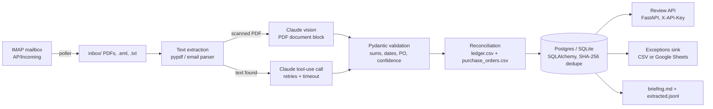

# doc-extract-pipeline

**An inbox agent for accounts payable.** Invoices, receipts and supplier emails arrive by IMAP
(or a watched folder); the pipeline extracts structured data with Claude, validates it with
deterministic rules, reconciles it against the payments ledger and purchase orders, stores the
result in Postgres, and publishes an exceptions queue, a review API and a daily briefing.

Every vendor, invoice and payment in this repository is fictional and generated by
`scripts/gen_samples.py`. The sample set is kept as a fixture so the whole system can be run
and tested without an API key, a mailbox or a database server.

## Architecture



| Stage | What happens | Module |
|---|---|---|
| Ingest | `DOCPIPE_INGEST_MODE=imap` polls a mailbox, saves supported attachments (and the mail itself as `.eml` when there is no attachment) into the inbox folder, archives every raw message under `out/mail_archive/`, and moves the mail to a done folder. `folder` mode just reads the inbox directory. | `ingest/imap.py` |
| Dedupe | SHA-256 of each file is checked against the `documents` table before any model call. Re-runs never re-bill or double-count. | `pipeline.py`, `store.py` |
| Extract | `pypdf` text for digital PDFs, headers + body for `.eml`/`.txt`. PDFs without a text layer are sent to Claude as a document block (vision), no poppler needed. | `extract.py` |
| Classify + structure | One Claude call with a strict tool schema. Wrapped in tenacity: exponential backoff with jitter on 429/5xx/connection/timeout, `DOCPIPE_LLM_MAX_RETRIES` attempts, `DOCPIPE_LLM_TIMEOUT_SECONDS` per attempt. Token usage, estimated cost, latency and request id are logged per call and summed per run. | `llm.py` |
| Validate | Rules the model is not trusted with: subtotal + tax = total, line items sum, ISO dates, due after issue, PO present, confidence >= 0.8. Failures set `needs_review`. | `validate.py` |
| Reconcile | Fuzzy vendor match, then paid / unpaid / overdue / partially paid / overpaid / duplicate / unknown vendor; PO amount mismatches noted. | `reconcile.py` |
| Persist | Normalised tables: `documents`, `invoices`, `line_items`, `reconciliation_results`, `review_decisions`. Postgres in production, SQLite by default locally and in tests. | `db.py`, `store.py`, `alembic/` |
| Review | FastAPI service: list and filter documents, approve or reject with a reviewer and note, read the briefing. | `api.py` |
| Report | `extracted.jsonl`, `exceptions.csv` (or a Google Sheets worksheet), `briefing.md`. | `report.py`, `sink.py` |

**Failure isolation.** A document that raises anywhere in the chain (unreadable file, model
error after retries, validation bug) is stored with `status=failed` and the error text, flagged
for review, listed in the exceptions sink and in a "Failed" section of the briefing. The run
continues with the next file and `docpipe run` exits with code 2 so a scheduler can alert.

**Logging.** structlog, JSON lines on stderr by default (`DOCPIPE_LOG_FORMAT=console` for local
work). Every line carries `run_id`; `llm.call` lines carry tokens and cost, `run.done` carries the
totals.

## Quickstart (no key needed)

```bash
git clone https://github.com/Gravityglitch/doc-extract-pipeline && cd doc-extract-pipeline
uv sync
uv run docpipe run --mock          # fixture extractor, SQLite at out/docpipe.db
cat out/briefing.md
uv run docpipe run --mock          # second pass: processed 0, skipped 10

DOCPIPE_API_KEY=dev uv run docpipe api   # http://127.0.0.1:8000/docs
curl -H 'X-API-Key: dev' localhost:8000/documents?needs_review=true

make lint test                     # ruff + pytest with 80% coverage gate
```

With a key: `cp .env.example .env`, set `ANTHROPIC_API_KEY`, then `uv run docpipe reset --yes
&& uv run docpipe run -v`. `scripts/eval.py` scores the live run against the ground truth.

## Deploy

### Docker Compose (reference stack)

```bash
cp .env.example .env         # at minimum: ANTHROPIC_API_KEY, DOCPIPE_API_KEY, IMAP settings
make up                      # builds the image, starts db, migrate, runner, api
make logs
```

Services: `db` (Postgres 16), `migrate` (`alembic upgrade head`, runs once), `runner`
(`docpipe loop`, one pass every `DOCPIPE_RUN_INTERVAL_SECONDS`), `api` (`docpipe api` on port
8000). The image is multi-stage, built with uv, runs as a non-root user and mounts `./inbox`,
`./data` and `./out`.

### Anywhere else

Run the same two processes under your scheduler of choice:

- `docpipe run` on a cron (exit 0 clean, 2 if any document failed), or `docpipe loop` as a long-lived service.
- `docpipe api` behind a reverse proxy that terminates TLS.

Schema: on Postgres run `alembic upgrade head` before the first start; the app does not
`create_all` against Postgres unless `DOCPIPE_AUTO_CREATE_SCHEMA=true`. On SQLite the schema is
created automatically.

### Health

`GET /health` (process up) and `GET /ready` (runs `SELECT 1` against the database, 503 on
failure) are unauthenticated and suitable for load-balancer probes.

## Configuration

All settings are read from the environment (or `.env`) and validated at startup; a missing
or inconsistent value fails fast with a message naming the variable. `.env.example` lists each
one with a comment.

| Variable | Default | Purpose |
|---|---|---|
| `ANTHROPIC_API_KEY` | - | Required unless `DOCPIPE_MOCK=true`. |
| `DOCPIPE_MODEL` | `claude-sonnet-5-5` | Extraction model. |
| `DOCPIPE_LLM_TIMEOUT_SECONDS` | `120` | Per-attempt timeout for a Claude call. |
| `DOCPIPE_LLM_MAX_RETRIES` | `3` | Retries after the first attempt on 429/5xx/network errors. |
| `DOCPIPE_MOCK` | `false` | Use the fixture extractor (tests, demos). |
| `DATABASE_URL` | `sqlite:///./out/docpipe.db` | SQLAlchemy URL; use `postgresql+psycopg://...` in production. |
| `DOCPIPE_AUTO_CREATE_SCHEMA` | unset | Override schema policy (SQLite auto-creates, Postgres relies on alembic). |
| `DOCPIPE_INBOX_DIR` / `DOCPIPE_DATA_DIR` / `DOCPIPE_OUT_DIR` | `./inbox`, `./data`, `./out` | Working folders. |
| `DOCPIPE_FIXTURES_FILE` | `tests/fixtures/extractions.json` | Fixture extractor source for mock mode. |
| `DOCPIPE_AS_OF` | today | Reconciliation date (overdue calculations). |
| `DOCPIPE_INGEST_MODE` | `folder` | `folder` or `imap`. |
| `DOCPIPE_IMAP_HOST` / `PORT` / `USER` / `PASSWORD` / `SSL` | `-`, `993`, `-`, `-`, `true` | Mailbox credentials; all required in imap mode. |
| `DOCPIPE_IMAP_MAILBOX` | `INBOX` | Folder/label to poll. |
| `DOCPIPE_IMAP_DONE_MAILBOX` | `AP/Processed` | Where processed mail is moved (created if missing). |
| `DOCPIPE_API_KEY` | - | Shared secret for the review API (`X-API-Key`). Required by `docpipe api`. |
| `DOCPIPE_API_HOST` / `DOCPIPE_API_PORT` | `0.0.0.0` / `8000` | Bind address. |
| `DOCPIPE_SINK` | `csv` | `csv` or `sheets`. |
| `DOCPIPE_SHEETS_SPREADSHEET_ID` / `DOCPIPE_SHEETS_WORKSHEET` | - / `exceptions` | Target sheet for the sheets sink. |
| `GOOGLE_APPLICATION_CREDENTIALS` | - | Service-account JSON for the sheets sink (`uv sync --extra sheets`). |
| `DOCPIPE_RUN_INTERVAL_SECONDS` | `300` | Sleep between passes in `docpipe loop`. |
| `DOCPIPE_LOG_LEVEL` / `DOCPIPE_LOG_FORMAT` | `INFO` / `json` | Logging. |

## Review API

All routes except `/health` and `/ready` require `X-API-Key: $DOCPIPE_API_KEY`.

| Route | Purpose |
|---|---|
| `GET /documents?status=processed&needs_review=true` | List; `status` is one of `processed`, `failed`, `approved`, `rejected`. |
| `GET /documents/{id}` | Full record: invoice, issues, reconciliation, decisions, error. |
| `POST /documents/{id}/approve` `{"reviewer": "...", "note": "..."}` | Records the decision, sets status `approved`, clears `needs_review`. |
| `POST /documents/{id}/reject` | Same, status `rejected`; rejected invoices no longer count for duplicate detection. |
| `GET /briefing?as_of=YYYY-MM-DD` | Markdown briefing regenerated from the store. |

Failed documents return 409 on approve/reject: fix the cause and re-run them instead.
Auth is a single shared secret; the service expects to sit behind a VPN or an authenticating
proxy, and per-user auth is the first thing to add if it does not.

## Runbook

**Daily run.** The compose `runner` (or your cron) polls the mailbox, processes new files and
rewrites `exceptions.csv`/the sheet and `briefing.md`. Check the `run.done` log line for
`processed`, `failed`, `skipped`, token and cost totals.

**Handling exceptions.** Open `GET /documents?needs_review=true` (or the sheet). For each
item: approve or reject through the API with your name and a note. Decisions are stored in
`review_decisions` and reflected in the next briefing (`(approved)` / `(rejected)` markers,
removed from the queue).

**A document failed.** `GET /documents?status=failed` shows the error text. Fix the cause
(bad file, model outage, bug), then:

```bash
uv run docpipe rerun inv_1005_northwind_equipment.pdf   # forget it by source file name
uv run docpipe run                                      # only that file is reprocessed
```

`rerun` works for any stored document, not only failed ones, e.g. after editing the ledger.

**Mail that could not be fetched** stays in the source mailbox and is retried on the next
poll; the poll result and the per-message error are logged (`imap.error`).

**Start over.** `docpipe reset --yes` deletes every row and the output files (it asks for
confirmation against a non-SQLite database).

**Cost.** Each `llm.call` line carries `input_tokens`, `output_tokens` and `cost_usd` from
the built-in price table (`llm.PRICING_PER_MTOK`); unknown models log `0.0`. A plain invoice is
roughly 1-2k input tokens; the Message Batches API would halve the cost for overnight runs.

## The sample set and its traps

Ten documents, each built to exercise a path a real AP inbox will hit:

| File | Trap | Expected outcome |
|---|---|---|
| `inv_1001_sparkleclean.pdf` | none | paid |
| `inv_1002_metro_janitorial.pdf` | no PO number printed | unpaid, **needs review** (`missing_po`) |
| `inv_1002_metro_janitorial_resend.pdf` | same invoice re-sent as a reminder | **duplicate** |
| `inv_1003_brightway_uniforms.pdf` | ledger shows 540 paid on a 480 invoice | **overpaid** by 60 |
| `inv_1005_northwind_equipment.pdf` | printed total 1180, but 900 + 180 tax = 1080 | **needs review** (`totals_mismatch`), PO mismatch noted |
| `rcpt_2201_quickfuel.pdf` | a receipt, not an invoice | classified `receipt`, matched to card payment |
| `inv_1007_acme_pest.pdf` | vendor not in PO list or ledger, cites a non-existent PO | **unknown vendor** |
| `inv_1008_sparkleclean.pdf` | 1000 paid of 1650 | **partially paid** |
| `email_brightway_inv_1009.txt` | invoice pasted into an email body; due 19 days ago | **overdue** |
| `email_newsletter.txt` | supplier marketing email | classified `other`, no reconciliation |

The briefing for this set (mock run, as of 2026-10-08) lists the seven "needs attention" rows,
an approval queue of three, and two clean documents; `out/exceptions.csv` carries the same rows
with `id`, `status`, issue codes and detail.

## Accuracy

`scripts/eval.py` compares `out/extracted.jsonl` with the ground truth in
`tests/fixtures/extractions.json` (classification for all 10 documents, 8 header fields on each
of the 9 billable documents = 72 fields).

| Run | Classification | Fields |
|---|---|---|
| `--mock` (fixture extractor) | 10/10 | 72/72 by construction; proves validation, reconciliation, persistence and reporting, not the model |
| `claude-sonnet-5-5`, live | not measured: this build was produced without an `ANTHROPIC_API_KEY` | `docpipe reset --yes && docpipe run && python scripts/eval.py` prints the numbers |

The sample PDFs are clean machine-generated text, so a live run should score at or near 100%
on them. That says nothing about your documents: real-world accuracy depends on scan quality,
vendor layouts and the fields you ask for, and is what a pilot on 50-100 real invoices
establishes before go-live.

## Limits and decisions

- **Email bodies vs attachments.** When a mail carries a supported attachment, only the
  attachment is processed; the body is archived but not fed to the model. This avoids a
  near-duplicate row per invoice. Mails with no supported attachment are processed as `.eml`.
- **Review decisions are terminal.** Approve/reject sets the status and clears the review flag;
  there is no "correct the fields" action yet. Corrections would be the natural next step and the
  right data to feed back as few-shot examples.
- **One shared API key.** Adequate behind a VPN or SSO proxy; not a substitute for per-user auth.
- **Google Sheets sink is exercised against a fake `gspread` only.** It has not been run against
  a live spreadsheet in this build.
- **Ledger and POs are CSV files.** `Records.load` is the single place to swap in a Xero/QuickBooks
  export or API.
- **Scanned documents** go straight to vision. At high volume an OCR pass first (Tesseract or a
  cloud OCR) with vision as the fallback is cheaper.
- **The model never does arithmetic that matters.** It copies what is printed; Python checks the
  sums (INV-1005 shows why).
- **Postgres schema is alembic-managed.** `alembic revision --autogenerate` after changing `db.py`.

## Development

```bash
make lint          # ruff check + format --check
make test          # pytest, coverage >= 80%
make docker-build  # same image CI builds
uv run alembic upgrade head    # against DATABASE_URL
```

CI (`.github/workflows/ci.yml`) runs lint, format check, tests with the coverage gate and a
Docker build on every push and pull request.

```
src/docpipe/
  config.py        pydantic-settings, validated at startup   api.py         review API
  logging_setup.py structlog JSON + run_id                   runner.py      loop for the scheduler
  ingest/imap.py   IMAP poller (+ fake_imap.py for tests)    sink.py        CSV / Google Sheets
  extract.py       pypdf, email parsing                       db.py          SQLAlchemy models
  llm.py           Claude extractor, retries, usage/cost      store.py       persistence, dedupe
  validate.py      business rules                             reconcile.py   ledger + PO matching
  report.py        jsonl / csv / briefing                     pipeline.py    orchestration, isolation
  cli.py           run | loop | poll | api | briefing | rerun | reset
alembic/           migrations (0001_initial_schema)
scripts/           gen_samples.py (fixtures), eval.py (live accuracy)
tests/             61 tests, offline, < 5 s
```

## License

MIT.
