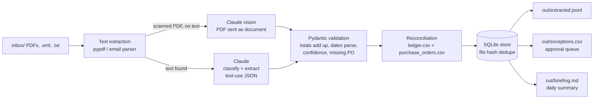

# doc-extract-pipeline

**An inbox agent for accounts payable.** Drop invoices, receipts and supplier emails into a
folder; get back validated structured data, a reconciliation against your payments ledger and
purchase orders, an exceptions list for a human to approve, and a daily briefing in Markdown.

> Demo build. Every vendor, invoice and payment here is fictional and generated by
> `scripts/gen_samples.py`. The pipeline is real and runs end to end; the production notes at
> the bottom describe what changes for a live deployment.

## What it does



| Stage | What happens | Where |
|---|---|---|
| Ingest | Every `.pdf`, `.eml`, `.txt` in `inbox/`; SHA-256 of the file is checked against SQLite so re-runs never re-bill or double-count | `extract.py`, `store.py` |
| Extract | `pypdf` text for digital PDFs; email headers + body for `.eml`. If a PDF has no text layer (a scan), the PDF bytes are sent to Claude as a document block instead - no `pdf2image`/poppler needed | `extract.py`, `llm.py` |
| Classify + structure | One Claude call (`claude-sonnet-5-5` by default) with a strict tool schema returns `{doc_type, confidence, invoice{vendor, invoice_number, date, due_date, line_items[], subtotal, tax, total, currency, po_number}}` straight into Pydantic models | `llm.py`, `models.py` |
| Validate | Deterministic checks the model cannot be trusted with: subtotal + tax = total, line items sum to subtotal, ISO dates parse, due date after issue date, PO present, confidence above 0.8. Failures set `needs_review` | `validate.py` |
| Reconcile | Fuzzy vendor match, then: paid / unpaid / overdue / partially paid / overpaid / duplicate / unknown vendor; PO amount mismatches are noted | `reconcile.py` |
| Report | JSONL of everything, CSV of exceptions, Markdown briefing with an approval checklist | `report.py` |

## Quickstart

```bash
git clone https://github.com/Gravityglitch/doc-extract-pipeline && cd doc-extract-pipeline
uv sync

# No API key? Run with the deterministic fixture extractor to see every stage work:
uv run docpipe run --mock
cat out/briefing.md

# With a key (copy .env.example to .env, or export ANTHROPIC_API_KEY):
uv run docpipe reset          # clear the store so files are reprocessed
uv run docpipe run -v         # real Claude extraction
uv run python scripts/eval.py # score the extraction against ground truth

uv run docpipe briefing       # regenerate the briefing from the store
uv run pytest && uv run ruff check
```

Regenerate the sample inbox at any time with `uv run python scripts/gen_samples.py`.

## The sample set and its traps

Ten documents, each built to exercise a path a real AP inbox will hit:

| File | Trap | Expected outcome |
|---|---|---|
| `inv_1001_sparkleclean.pdf` | none | paid |
| `inv_1002_metro_janitorial.pdf` | no PO number printed | unpaid, **needs review** (`missing_po`) |
| `inv_1002_metro_janitorial_resend.pdf` | same invoice re-sent as a reminder | **duplicate** |
| `inv_1003_brightway_uniforms.pdf` | ledger shows 540 paid on a 480 invoice | **overpaid** by 60 |
| `inv_1005_northwind_equipment.pdf` | printed total 1180, but 900 + 180 tax = 1080 | **needs review** (`totals_mismatch`), PO mismatch noted |
| `rcpt_2201_quickfuel.pdf` | a receipt, not an invoice | classified `receipt`, matched to card payment |
| `inv_1007_acme_pest.pdf` | vendor not in PO list or ledger, cites a non-existent PO | **unknown vendor** |
| `inv_1008_sparkleclean.pdf` | 1000 paid of 1650 | **partially paid** |
| `email_brightway_inv_1009.txt` | invoice pasted into an email body; due 19 days ago | **overdue** |
| `email_newsletter.txt` | supplier marketing email | classified `other`, no reconciliation |

## Sample briefing output

```markdown
# Daily AP briefing - 2026-10-08

Processed **10** documents: 8 invoices, 1 receipts, 1 other.

## Payment status

| Status | Count |
|---|---|
| paid | 2 |
| unpaid | 2 |
| overdue | 1 |
| partially_paid | 1 |
| overpaid | 1 |
| duplicate | 1 |
| unknown_vendor | 1 |

**Outstanding payable:** 2,652.00 USD

## Needs attention

| File | Vendor | Invoice | Total | Status | Why |
|---|---|---|---|---|---|
| email_brightway_inv_1009.txt | Brightway Uniforms | INV-1009 | 360.00 USD | overdue | Unpaid, due 2026-09-19 (19 days ago) |
| inv_1002_metro_janitorial.pdf | Metro Janitorial Wholesale | INV-1002 | 462.00 USD | unpaid | No PO number on invoice |
| inv_1002_metro_janitorial_resend.pdf | Metro Janitorial Wholesale | INV-1002 | 462.00 USD | duplicate | INV-1002 from Metro Janitorial Wholesale was already processed |
| inv_1003_brightway_uniforms.pdf | Brightway Uniforms | INV-1003 | 480.00 USD | overpaid | Overpaid by 60.00 |
| inv_1005_northwind_equipment.pdf | Northwind Equipment Hire | INV-1005 | 1,180.00 USD | unpaid | subtotal 900.00 + tax 180.00 != total 1180.00 |
| inv_1007_acme_pest.pdf | Acme Pest Control | INV-1007 | 385.00 USD | unknown_vendor | 'Acme Pest Control' not in purchase orders or ledger |
| inv_1008_sparkleclean.pdf | SparkleClean Supplies Ltd | INV-1008 | 1,650.00 USD | partially_paid | Outstanding 650.00 of 1650.00 |

## Approval queue (3 awaiting human review)

- [ ] `inv_1002_metro_janitorial.pdf` - confidence 0.93; issues: missing_po
- [ ] `inv_1002_metro_janitorial_resend.pdf` - confidence 0.92; issues: missing_po
- [ ] `inv_1005_northwind_equipment.pdf` - confidence 0.90; issues: totals_mismatch

## Clean

- SparkleClean Supplies Ltd INV-1001 - 1,100.00 USD - paid
- QuickFuel Station RCPT-2201 - 74.71 USD - paid
```

`out/exceptions.csv` carries the same seven rows with issue codes, ready for a spreadsheet or
Google Sheets sink. `out/extracted.jsonl` has one full record per document (fields, issues,
reconciliation, extraction method, file hash).

## Accuracy on the sample set

`scripts/eval.py` compares `out/extracted.jsonl` with the ground truth in
`tests/fixtures/extractions.json` (classification for all 10 documents; 8 header fields on each of
the 9 billable documents = 72 fields).

| Run | Classification | Fields |
|---|---|---|
| `--mock` (fixture extractor) | 10/10 | 72/72 - by construction; this proves the validation, reconciliation and reporting stages, not the model |
| `claude-sonnet-5-5`, live | not yet measured - this build was produced without API access | run `docpipe reset && docpipe run && python scripts/eval.py` and the numbers print |

The sample PDFs are clean, machine-generated text, so a live run should score at or near 100%
on them. That is not a claim about your documents: real-world accuracy depends on scan quality,
vendor layouts and how many fields you ask for, and is exactly what a short pilot on 50-100 of
your real invoices would establish before going live.

## Design choices worth knowing

- **The model never does arithmetic that matters.** It copies what is printed; Python checks the
  sums. INV-1005 shows why - the printed total is wrong, and a model "fixing" it would hide the
  problem.
- **Strict tool schema, not free-form JSON.** Claude's strict tool use guarantees the response
  matches the schema, so parsing never fails; Pydantic then applies business validation.
- **Every document gets a confidence and a `needs_review` flag.** The approval queue is the
  contract with the human: nothing with an error-level issue, a missing PO or confidence below
  0.8 is treated as settled.
- **Idempotent by file hash.** Re-running the folder costs nothing and never double-counts.
  Duplicate detection is separate and content-based (vendor + invoice number), so a re-sent
  invoice in a differently named file is still caught.
- **Swappable extractor.** `Extractor` is a two-line protocol; tests and `--mock` use a fixture
  implementation, so the whole suite runs in under a second with no key.

## Production notes

What changes between this demo and a deployment:

- **Ingestion.** Replace the `inbox/` folder with an IMAP/Gmail API poller (label-based: `AP/Incoming`
  -> `AP/Processed`), saving attachments and the email body as `.eml`. Same `load_document` entry point.
- **Scanned documents.** The vision fallback is already wired (PDF sent as a document block when
  `pypdf` finds no text). For high volumes, add a cheap OCR pass (Tesseract or a cloud OCR) and
  only escalate to vision when OCR confidence is low.
- **Sink.** Swap the CSV writers for a Google Sheets (gspread) or Postgres sink; the
  `ProcessedDocument` model is already flat enough to be a sheet row. Keep SQLite/Postgres as the
  system of record and treat Sheets as a view.
- **Human review UI.** The approval queue is a Markdown checklist today. A small FastAPI +
  HTMX page (or a Retool/Appsmith table over the DB) with approve / correct / reject actions is
  one to two days of work; corrections should be stored and fed back as few-shot examples.
- **Ledger source.** Point `Records.load` at Xero/QuickBooks exports or their APIs instead of CSVs.
- **Reliability and cost.** The Anthropic SDK retries 429/5xx with backoff by default. At roughly
  1-2k input tokens per invoice, `claude-sonnet-5-5` costs well under a cent per document; the
  Message Batches API halves that for overnight runs. Put the static system prompt and tool
  schema under prompt caching if volumes grow.
- **Observability.** Log request ids, token usage and per-document latency; alert when the
  needs-review rate drifts, which is the earliest signal that a vendor changed their template.
- **Security.** Keys via environment or a secrets manager, never in the repo; the `.env.example`
  pattern here is the minimum. Invoices are PII-adjacent - keep retention policies in mind.

## Project layout

```
src/docpipe/
  extract.py    text extraction (pypdf, email)      reconcile.py  ledger + PO matching
  llm.py        Claude extractor + fixture extractor store.py      SQLite, dedupe
  validate.py   business rules, needs_review         report.py     jsonl / csv / briefing
  models.py     Pydantic models                      pipeline.py   orchestration
  cli.py        `docpipe run | briefing | reset`
scripts/gen_samples.py   builds inbox/, data/*.csv and the ground-truth fixture
scripts/eval.py          scores a live run against ground truth
tests/                   22 tests, no network, < 1 s
```

## License

MIT.
